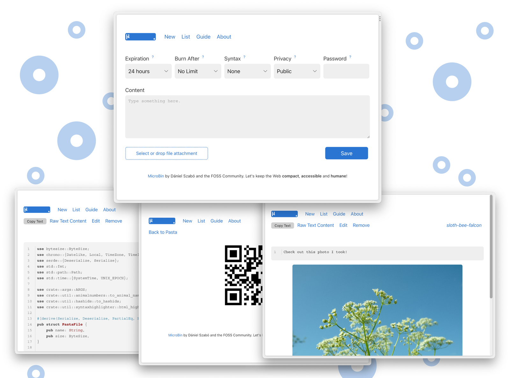

*MicroBin's upload page — upstream screenshot from the MicroBin project (`.github/index.png`). The live UI was verified rendering during end-to-end testing of this template's own deployment.*

# MicroBin

MicroBin is a super tiny, feature-rich, self-contained pastebin and file-sharing web app written in Rust. Paste text, upload a file, or shorten a URL — each upload gets a memorable animal-name link (like `server.com/pasta/pig-dog-cat`), with optional expiry, burn-after-reading, client- or server-side encryption, and QR codes. One-click deploy creates a single Rust service with a persistent volume and no companion database: pastas, files, and settings live in SQLite on the volume. After deploy, open the public URL and paste — no account needed to upload; log in at `/auth_admin` (username `admin`, generated password from the deploy form) to manage uploads.

## Source Repository

[https://github.com/INAPP-Mobile/microbin](https://github.com/INAPP-Mobile/microbin)

## Deploy and Host

Deploying MicroBin on Railway gives you a private pastebin on your own volume. The wrapper maps Railway's injected `PORT` onto MicroBin's HTTP port on every boot (upstream ignores the generic `PORT`), derives the public URL at boot from the live Railway domain, and seeds a generated admin password from the deploy form instead of the upstream default. The deploy form has one generated field and nothing to type.

## Why Deploy

- Your pastes, your files: uploads live in SQLite and a file store on your own Railway volume — not in a chat log or a SaaS that can disappear.
- Tiny footprint: a single Rust binary, a few MB of RAM at rest — no database service to run or pay for.
- No account needed to share: anyone with the link can read a public pasta, so a shared link just works.
- Animal-name links: uploads get memorable names instead of random strings, and the built-in QR code puts a link on a phone in one scan.
- Private by design: expiry, burn-after-reading, and client-side encryption mean a paste can self-destruct or stay unreadable on the server.
- URL shortener included: paste a URL and MicroBin redirects it, so the same deploy covers quick link shortening.

## Common Use Cases

- Moving text and files between machines: paste on the desktop, open the animal-name link on the server.
- Sharing a file too large for chat: upload it and send the link instead of splitting a zip.
- A personal postbox: people can upload files or texts to you without seeing what others sent.
- Quick notes and code snippets: paste, set an expiry, and share the link.
- Serving small static content: the Raw view serves a pasta's content directly, handy for config files and test fixtures.

## Configuration

| Variable | Default | Description |
| --- | --- | --- |
| `MICROBIN_ADMIN_PASSWORD` | `${{secret(16)}}` | Admin password for `/auth_admin` (username `admin`). Generated per deploy; the upstream default (`m1cr0b1n`) is never used. |
| `MICROBIN_ADMIN_USERNAME` | `admin` | Admin username. Baked into the image; set the variable to change it. |
| `MICROBIN_PORT` | (derived from `$PORT` at boot) | HTTP port MicroBin listens on. Set by the entrypoint from Railway's injected `PORT`; do not set it yourself. |
| `MICROBIN_DATA_DIR` | `/data` | Data home on the volume: `database.sqlite`, `attachments/`, `public/`. Baked into the image. |
| `MICROBIN_PUBLIC_PATH` | (derived from `RAILWAY_PUBLIC_DOMAIN` at boot) | Public URL of the instance. Makes copy-URL and QR links correct behind the proxy. Set manually only for a custom domain. |
| `MICROBIN_DISABLE_TELEMETRY` | `true` | Disables the upstream telemetry thread. Baked into the image. |
| `MICROBIN_DISABLE_UPDATE_CHECKING` | `true` | Disables the upstream update check (the version is pinned here). Baked into the image. |
| `MICROBIN_TITLE` | (unset) | Instance title shown in the header instead of "MicroBin". |
| `MICROBIN_DEFAULT_EXPIRY` | `24hour` | Default expiry for new uploads: `24hour`, `1week`, `1month`, `1year`, `never`, and more. |
| `MICROBIN_MAX_EXPIRY` | `1week` | Longest expiry users may pick. |
| `MICROBIN_GC_DAYS` | `90` | Uploads unread for this many days are garbage-collected; `0` disables GC. |
| `MICROBIN_PRIVATE` | (unset) | Set to `true` so only the uploader's link works and uploads are hidden from the public listing. |
| `MICROBIN_NO_LISTING` | (unset) | Set to `true` to hide the public upload listing entirely. |
| `MICROBIN_READONLY` | (unset) | Set to `true` to make the instance read-only (no new uploads). |
| `MICROBIN_ENABLE_BURN_AFTER` | `true` | Allow burn-after-reading uploads. |
| `MICROBIN_ENABLE_READONLY` | `true` | Allow per-upload read-only flag. |
| `MICROBIN_ENCRYPTION_CLIENT_SIDE` | `true` | Allow client-side encrypted uploads. |
| `MICROBIN_ENCRYPTION_SERVER_SIDE` | `true` | Allow server-side encrypted uploads. |
| `MICROBIN_JSON_DB` | (unset) | Set to `true` to store pastas as JSON files instead of SQLite. |
| `MICROBIN_UPLOADER_PASSWORD` | (unset) | Password required to upload at all; unset means anyone can upload. |
| `MICROBIN_BASIC_AUTH_USERNAME` / `MICROBIN_BASIC_AUTH_PASSWORD` | (unset) | HTTP Basic Auth in front of the whole site; both must be set to take effect. |
| `MICROBIN_HIDE_HEADER` / `MICROBIN_HIDE_FOOTER` / `MICROBIN_HIDE_LOGO` | (unset) | Hide parts of the page chrome. |
| `MICROBIN_FOOTER_TEXT` | (unset) | Custom footer text. |
| `MICROBIN_CUSTOM_CSS` | (unset) | Custom CSS file served with the page. |
| `MICROBIN_HASH_IDS` | (unset) | Hash upload IDs instead of animal names. |
| `MICROBIN_MAX_FILE_SIZE_UNENCRYPTED_MB` | `2048` | Max upload size (MB) for plain uploads. |
| `MICROBIN_MAX_FILE_SIZE_ENCRYPTED_MB` | `256` | Max upload size (MB) for encrypted uploads. |
| `MICROBIN_THREADS` | `1` | HTTP worker threads. |

## First-run notes

- **Admin login is `/auth_admin`.** Username `admin`, password is the generated value from the deploy form (find it in the service's Variables tab). The admin page lists every upload and warns if the default credentials are ever in use — they never are on this template.
- **No signup, no email step.** Anyone can upload by default; use `MICROBIN_UPLOADER_PASSWORD` or `MICROBIN_PRIVATE` if the instance should not be open.
- **Uploads survive redeploys.** Pastas and files live on the `/data` volume; redeploying the service keeps them.

### Deployment Dependencies

- A single MicroBin service (Rust, SQLite, no companion service).
- One persistent volume mounted at `/data` (database at `/data/database.sqlite`, file store at `/data/attachments`, public files at `/data/public`).
- Plan tier: Hobby is enough — the service idles at a few MB of RAM.

## Upstream

MicroBin v2.1.0 by [szabodanika](https://github.com/szabodanika/microbin), licensed BSD-3-Clause. Image pinned by manifest digest; see the `Dockerfile` header for the verified digest and the wrapper's design notes.
