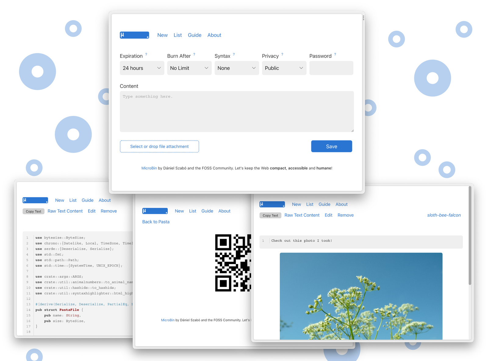

*MicroBin's upload page — upstream screenshot from the MicroBin project (`.github/index.png`).*

# Deploy and Host

MicroBin is a super tiny, feature-rich, self-contained pastebin and file-sharing web app written in Rust. Paste text, upload a file, or shorten a URL — each upload gets a memorable animal-name link, with optional expiry, burn-after-reading, encryption, and QR codes. One-click deploy creates a single Rust service with a persistent volume and no companion database: pastas, files, and settings live in a JSON store on the volume. After deploy, open the public URL and paste — no account needed to upload; log in at `/auth_admin` (username `admin`, generated password from the deploy form) to manage uploads.

## About Hosting

Hosting MicroBin on Railway keeps your pastes on your own volume instead of a SaaS. The deployment is a single always-on Rust service: the wrapper maps Railway's injected `PORT` onto MicroBin's HTTP port on every boot (upstream ignores generic `PORT`), derives the public URL at boot from the live Railway domain, and seeds a generated admin password from the deploy form instead of the upstream default. The deploy form has one generated field and nothing to type. Telemetry and update checks are disabled in the image.

## Why Deploy

- Your pastes, your files: uploads live in a JSON store and a file store on your own Railway volume — not in a chat log or a SaaS that can disappear.
- Tiny footprint: a single Rust binary, a few MB of RAM at rest — no database service to run or pay for.
- No account needed to share: anyone with the link can read a public pasta, so a shared link just works.
- Animal-name links: uploads get memorable names instead of random strings, and the built-in QR code puts a link on a phone in one scan.
- Private by design: expiry, burn-after-reading, and client-side encryption mean a paste can self-destruct or stay unreadable on the server.
- URL shortener included: paste a URL and MicroBin redirects it, so the same deploy covers quick link shortening.

## Common Use Cases

- Moving text and files between machines: paste on the desktop, open the animal-name link on the server.
- Sharing a file too large for chat: upload it and send the link instead of splitting a zip.
- A personal postbox: people can upload files or texts to you without seeing what others sent.
- Quick notes and code snippets: paste, set an expiry, and share the link.
- Serving small static content: the Raw view serves a pasta's content directly, handy for config files and test fixtures.

## Dependencies for

- A single MicroBin service (Rust, JSON store, no companion service).
- One persistent volume mounted at `/data` (JSON store at `/data/pasta_data/database.json`, file store at `/data/attachments`, public files at `/data/public`).
- Environment variables (condensed reference — full documentation in the repo README):

| Variable | Default | Description |
| --- | --- | --- |
| `MICROBIN_ADMIN_PASSWORD` | `${{secret(16)}}` | Admin password for `/auth_admin` (username `admin`). Generated per deploy; the upstream default is never used. |
| `MICROBIN_ADMIN_USERNAME` | `admin` | Admin username. Baked into the image. |
| `MICROBIN_PORT` | (derived from `$PORT` at boot) | HTTP port MicroBin listens on. Set by the entrypoint from Railway's injected `PORT`. |
| `MICROBIN_DATA_DIR` | `/data` | Data home on the volume. Baked into the image. |
| `MICROBIN_PUBLIC_PATH` | (derived from `RAILWAY_PUBLIC_DOMAIN` at boot) | Public URL of the instance. Set manually only for a custom domain. |
| `MICROBIN_DISABLE_TELEMETRY` | `true` | Disables the upstream telemetry thread. Baked into the image. |
| `MICROBIN_DISABLE_UPDATE_CHECKING` | `true` | Disables the upstream update check. Baked into the image. |

### Deployment Dependencies

- Plan tier: Hobby is enough — the service idles at a few MB of RAM.
- No companion database, no extra services.
